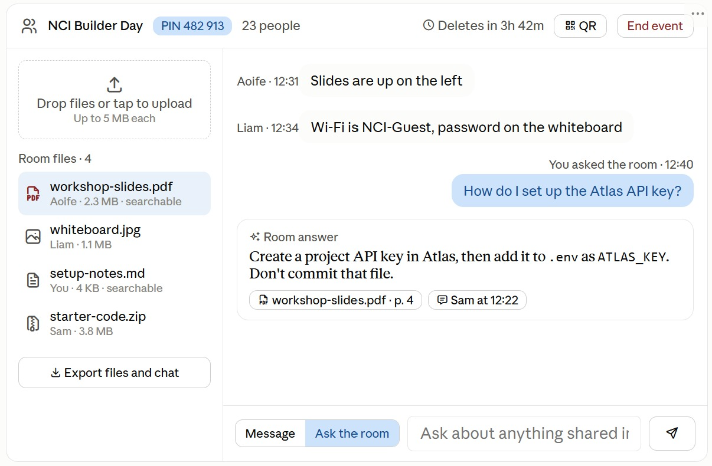

# Workspace — hackathon build plan

**A temporary workspace anyone joins by QR or PIN: files in a Google-Docs-style viewer, chat beside them, `@` file references, hybrid search over everything in it, and deletion by MongoDB TTL — embeddings included.** This page is the decision record and the execution plan in one. The product spec is [PRD.md](PRD.md); where the two disagree, this page wins and [Where this plan overrides the PRD](#where-this-plan-overrides-the-prd) says so.

Written 2026-10-03, 13:20. Public link and submission are due at **16:00 today**. Facts read from a command carry `[measured 2026-10-03]`.

## Context

The idea started as an "Event Room" ([Event Room_ MongoDB Hackathon Build Plan.mhtml](Event%20Room_%20MongoDB%20Hackathon%20Build%20Plan.mhtml)) and was reframed into the PRD. The reframing is the point: **it is a workspace, not an event.** The UI and the code say "workspace" everywhere. "Event" and "room" do not appear in any label. Socket.IO's own "room" is a library term and stays inside the server.

The current mock-up still carries the old framing — "End event" in the header and an "Ask the room" box under the chat. Both go. The layout around them stays.



### What the repo already has

Measured on `main` at `d3423e2` `[measured 2026-10-03]`:

- **Next.js 16.3.8 App Router at the repo root**, scaffold only (`app/page.tsx` is the create-next-app page). Tailwind 4, TypeScript 5, pnpm 12.4.1 via `packageManager`.
- **`server/db.js` and `scripts/db-ping.js`** from the `connected to mongo` commit: one pooled `MongoClient`, Stable API v1 non-strict so `$search` works, pool of 20.
- **Four defects from merging the two branches**, all fixed in P0:
    - `mongodb` is missing from `package.json`. The merge took `package-lock.json` but kept the Next `package.json`, so `pnpm install` never installs the driver and `db-ping.js` cannot run.
    - **Two lockfiles.** `package-lock.json` (npm) and `pnpm-lock.yaml` (pnpm) both exist.
    - `"type": "module"` is gone. `server/db.js` uses `import`, and the `connected to mongo` branch's `package.json` declared ESM.
    - `.gitignore` has `.env*`, which also ignores `.env.example`. `db.js`'s error message tells people to copy a file that can't be committed.

## Method

The shape is the `hook-maker` one from the recipe-app plan — spec, plan, probe, test-first, build, verify — squeezed into under three hours.

| Phase of the method | Here, today |
| --- | --- |
| Spec | The PRD, plus [Decisions](#decisions) below |
| Plan with Blocking Unknowns | This page |
| Probe | P0's hello-world deploy answers U1 to U4 in [Blocking Unknowns](#blocking-unknowns) |
| Tests, red first | Vitest on `lib/**` — pure functions only |
| Static checks | `tsc --noEmit` and `eslint` |
| Verify | Each phase's exit check, **on the Render URL, not localhost** |

**No openspec today.** One change per phase means four proposals in three hours. The PRD is the spec and this page is the plan. If the project continues after 16:00, each phase becomes an openspec change then.

## Decisions

| # | Decision | Answer |
| --- | --- | --- |
| 1 | Product noun | **Workspace.** Never event, never room, in UI or copy |
| 2 | Framework | **Next.js 16.3.8**, App Router, plus a custom `server.js` that hosts Socket.IO on the same HTTP server |
| 3 | Hosting | Render free web service running `server.js`. It has to be long-running, because the change stream stays open |
| 4 | Package manager | **pnpm 12.4.1**, already in `packageManager`. `package-lock.json` is deleted |
| 5 | Node | **24**, pinned in **both** `.node-version` and `engines.node` (`">=24 <25"`) — see task 0.2 |
| 6 | File storage | Files live inside Atlas documents. **Text as UTF-8 text, binary as base64** — see [File storage](#file-storage) |
| 7 | Layout | Files focus (small chat, big files) and Chat focus (small files, big chat), chat left or right, tabs on phones — see [P3 Differentiators](#p3-differentiators). **Default: Files focus, chat on the right** |
| 8 | File viewer | Google Docs feel: the open file fills the main pane under a top bar. GitHub-style rendering inside it |
| 9 | `@` references | Like Claude Code: type `@`, pick a file from a filtered list, it lands as a chip. Filtered **client-side over the already-loaded file list** — no index, no route. **P0** |
| 10 | Screenshot paste | Ctrl+V or drop an image into the chat input, posted inline, as in GitHub comments. **P0** |
| 11 | Ask the room (LLM answers) | **Dropped from the MVP.** Needs an API key nobody has today, plus prompt work and streaming — the feature most likely to be half-built at the freeze. Listed under next steps |
| 12 | Close | Host closes the workspace: hidden for everyone at once, TTL deletes every document within about 60 s |
| 13 | Lifetime | 1 to 48 h, extendable to 48 h from creation, per the PRD. The Event Room doc's 24 h cap is superseded |
| 14 | Search | **Hybrid search is in** — see [Semantic and hybrid search](#semantic-and-hybrid-search). `$vectorSearch` + `$search` fused by `$rankFusion`, embeddings generated by Atlas. No LLM, no API key, **no new npm dependency**. Gated on the clock: see [Order of work](#order-of-work). **Chat messages only `[2026-10-03 15:10]`**: files are not searched — "your files stay private" |
| 15 | Search index budget | **All three** of the Free tier's indexes are spent (two on `messages`, one on `files`). No spare — see [Risks](#risks) |

## File storage

**Every file is one document in `files`. Its bytes go into a string field `content`, and a field `encoding` says how to read it.**

| Kind of file | `encoding` | `content` holds | Read it by |
| --- | --- | --- | --- |
| Text: Markdown, code, CSV, plain text — and anything else whose bytes are valid UTF-8 | `"utf8"` | The text itself | Using it as is |
| Binary: images, PDF, zip, anything else | `"base64"` | The bytes, base64-encoded | `Buffer.from(content, "base64")` |

So a Markdown file in Data Explorer reads as Markdown. That is the reason for the split: the database holds something a person can read wherever it can.

**Why base64 for binary.** Raw bytes are not valid text. Forcing them through a UTF-8 decoder corrupts them, because some byte sequences have no UTF-8 meaning — a PNG starts with byte `0x89`, which can't begin a UTF-8 character. Base64 maps any bytes onto 64 plain ASCII characters, so the result is a safe string in a JSON document. Decoding returns the exact original bytes.

**How a file moves through the system:**

1. The browser uploads it as `multipart/form-data`, as raw bytes. Not base64 — that would add the overhead to the upload too.
2. The route handler checks the size **on the raw bytes**: over 5 MB (5 × 1024 × 1024 bytes) returns 413.
3. `lib/content.ts` decides the encoding: decode with `new TextDecoder("utf-8", { fatal: true })`; success means `"utf8"`, an exception means `"base64"`. A `.txt` holding invalid bytes therefore falls back to base64 and is never corrupted.
4. Insert `{ filename, mime, size, encoding, content, ... }`.
5. `GET /api/files/:id` decodes base64 back to a `Buffer` and sends it with the stored `mime`. A utf8 file goes out as is.

**What base64 costs, said once.** Base64 writes 4 characters for every 3 bytes, so a stored file is a third larger. A 5 MB file becomes **6,990,508 characters**. That fits the [16 MiB maximum BSON document size](<https://www.mongodb.com/docs/manual/reference/limits/>) with room to spare. It also counts in full against the Free cluster's 0.5 GB, because Atlas measures [the bytes of all uncompressed BSON documents plus their indexes](<https://www.mongodb.com/docs/atlas/reference/free-shared-limitations/>). The rejected alternative was BSON `BinData`, which stores raw bytes with no overhead and is what the PRD specified.

**Two rules that keep it fast:**

- The file-list query projects out `content`.
- The change stream projects out `fullDocument.content`. Without that, every upload pushes up to 7 MB through every socket in the workspace.

## Semantic and hybrid search

**One box searches every message and the inside of every text file. Keyword and meaning, fused by the database. The index expires with the data.**

Atlas generates the embeddings. A vector index field of `type: "autoEmbed"` embeds on insert, on update and at query time, so `$vectorSearch` takes a **plain string** rather than a vector. There is no embedding pipeline to write, no model key in `.env`, and no new npm dependency — field names read from the [Automated Embedding docs](<https://www.mongodb.com/docs/vector-search/crud-embeddings/automated-embedding/>).

**Three indexes, the Free tier's entire budget:**

| Index | Collection | Type | Definition | What it answers |
| --- | --- | --- | --- | --- |
| `messages_semantic` | `messages` | `vectorSearch` | `autoEmbed` on `text`, `modality: "text"`, `model: "voyage-4"`, plus `{type: "filter", path: "workspaceId"}` | meaning — "wifi pw" finds "the network password is hunter2" |
| `messages_text` | `messages` | `search` | `text` on `text`, `token` on `workspaceId` | exact words, names, numbers |
| `files_autocomplete` | `files` | `search` | `autocomplete` on `filename` (edgeGram, 2–20), **`string` on `content`**, `token` on `workspaceId` | file names, and the text inside text files |

**Why two indexes on one collection.** `$rankFusion` runs several pipelines, de-duplicates and combines them by reciprocal rank — but only within one collection. `messages_semantic` and `messages_text` together are therefore what make real hybrid search possible on chat. Fusing across collections in one stage is not possible, so `files` is keyword-only, which is the right trade: filenames and code are exact-match territory anyway.

**Why file contents are already searchable.** [File storage](#file-storage) stores every text file as UTF-8 in `content`. The text is already a plain string field, so pointing an index at it costs one line — no extraction step, no `pdf-parse`, no new dependency. This is the payoff for the `utf8`/`base64` split.

**Query shapes** for task 3.1:

```javascript
// semantic leg — note `query` is a string, not a vector
{ $vectorSearch: { index: 'messages_semantic', path: 'text', query: q,
                   filter: { workspaceId }, limit: 10, numCandidates: 100 } }

// keyword leg
{ $search: { index: 'messages_text', compound: {
    must:   [{ text: { query: q, path: 'text' } }],
    filter: [{ equals: { path: 'workspaceId', value: workspaceId } }] } } }

// fused — $rankFusion needs MongoDB 8.0, which Free runs. Native $rerank needs 8.3: skip it
{ $rankFusion: { input: { pipelines: { semantic: [...], keyword: [...] } } } }
```

**What to say to judges — the line that lands:**

> The vector index deletes itself. Every embedding is derived from a document carrying `expiresAt`, so when TTL fires the vectors go with it. Search the workspace after it closes and you get nothing back. Ephemeral AI: searchable while it exists, no index left behind.

Timing that claim is U9, and the probe comes before the promise.

## Stack

Registry versions `[measured 2026-10-03]` with `pnpm view`. **Planned** rows are not installed yet; the phase that adds them installs the current version, not this number.

| Concern | Package | Version | State |
| --- | --- | --- | --- |
| Framework | next | 16.3.8 | installed |
| UI | react, react-dom | 19.2.8 | installed |
| Styling | tailwindcss | 4.x | installed |
| Database | mongodb | 7.7.0 | in the lockfile, missing from `package.json` — P0 |
| Realtime | socket.io, socket.io-client | 4.8.4 | planned — P0 |
| Tests | vitest | 5.0.3 | planned — P0 |
| QR | qrcode | 1.5.4 | planned — P1 |
| Rendering | highlight.js | 11.12.0 | planned — P2 |
| Rendering | marked + dompurify | 18.0.14 + 3.4.16 | planned — P2 |
| Embeddings | *(none — Atlas-side)* | `voyage-4` | **no package.** Automated Embedding runs inside Atlas — P3 |
| Runtime | node | 24.18.0 local | Render's default for new services is [24.21.0](<https://render.com/docs/node-version>) |

**Why a custom server at all.** The installed Next docs say a custom server should only be used when the integrated router can't meet the app's requirements (`node_modules/next/dist/docs/01-app/02-guides/custom-server.md`, read from 16.3.8). A WebSocket server sharing the app's port is that case. The cost: a custom server [can't be deployed on Vercel](<https://socket.io/how-to/use-with-nextjs>), which doesn't matter on Render. And `server.js` doesn't go through the Next compiler, so it stays plain JavaScript that Node 24 runs directly.

**Pin Node with an upper bound.** Render resolves an unbounded range such as `>=22` to the newest Node release, and its docs say to [always include an upper bound](<https://render.com/docs/node-version>). The `connected to mongo` branch's `package.json` had exactly `>=22`, and that is still what is committed `[measured 2026-10-03]`. **`.node-version` alone does not close it** — Render reads `engines` too, so task 0.2 sets both.

## Blocking Unknowns

Unverified **in this environment**, named as questions rather than assumed. P0's first deploy answers U1 to U4.

| # | Question | Why it's genuinely unknown | Probe |
| --- | --- | --- | --- |
| **U1** | Does Socket.IO 4.8.4 attach to a Next 16.3.8 custom server, in dev and in production, on Render? | [Socket.IO's Next guide](<https://socket.io/how-to/use-with-nextjs>) shows the pattern, but it hardcodes `hostname = "localhost"`. Render needs the server reachable from outside, and Next 16's dev server runs its own HMR socket on the same port | `server.js` with one `ping` → `pong` event, a test page, deployed |
| **U2** | Do `server.js` and the route handlers share one `server/db.js` module instance? | Next bundles route handlers itself, and `server.js` imports natively. Two instances mean two `MongoClient` pools and no shared `io` | Log a counter from both sides. If they differ, keep the client and `io` on `globalThis` |
| **U3** | Does Render install pnpm 12.4.1 from `packageManager`? | Search surfaced a [Render community thread](<https://community.render.com/t/err-pnpm-bad-pm-version-this-project-is-configured-to-use-v9-0-4-of-pnpm-your-current-pnpm-is-v9-0-2/20966>) recommending `corepack enable && pnpm install && pnpm build`, but the page wouldn't load. **Treat that as rumour, not finding** | First deploy with that build command. Fallback: `npx pnpm@12.4.1 install --frozen-lockfile && npx pnpm@12.4.1 build` |
| **U4** | Does an App Router route handler accept a 5 MB multipart body with no config? | The installed docs name two limits, and neither is for route handlers: Server Actions default to 1 MB (`serverActions.md`), and `proxyClientMaxBodySize` defaults to 10 MB but only applies when a proxy file exists (`proxyClientMaxBodySize.md`) | Upload 4.9 MB (expect 201) and 5.1 MB (expect 413) |
| **U5** | Does `createSearchIndex` work from `setup.js` on the Free tier? | The PRD already plans for it failing | Run `setup.js`. On failure, create the index in the Atlas UI |
| **U6** | How many Search indexes does the Free tier allow? | The PRD says 3 for Search **and vector combined**. The [Free cluster limits page](<https://www.mongodb.com/docs/atlas/reference/free-shared-limitations/>) doesn't state it. **This plan now uses exactly 3, so it can block** | Create all three in `setup.js` (task 0.5b) and read the error if the third is refused. Fallback: drop `messages_text` and lose `$rankFusion`, keeping plain `$vectorSearch` |
| **U7** | Does `createSearchIndex` build an **`autoEmbed` vector** index on the Free tier? | U5 settled that `createSearchIndex` works there for a *Search* index, which is encouraging but not the same question. The [Automated Embedding docs](<https://www.mongodb.com/docs/vector-search/crud-embeddings/automated-embedding/>) give the field names and a [product update](<https://www.mongodb.com/products/updates/now-ga-automated-embedding-in-atlas-vector-search/>) announces GA on Atlas — but that docs page also carries a **Preview, not for production** banner covering the self-managed build, and says nothing about the Free tier. **Treat GA-on-Atlas as likely, not settled** | Add it to `setup.js` (0.5b) and read the error verbatim. On failure, create it in the Atlas UI |
| **U8** | What is the Automated Embedding rate limit on this cluster? | The research doc says 3 queries/min without a payment method and 2,000/min with one. The docs say limits are per API key and configurable in the Atlas UI, and **do not confirm the 3/min figure**. 3/min would end the demo the moment two judges type at once | Add a payment method **before the search slot** (it stays $0 — 200M free tokens per model), then read the key's limits in the Atlas UI |
| **U9** | How soon after a message is inserted can `$vectorSearch` find it — and how soon after TTL deletes it does it stop being found? | Automated Embedding generates vectors **asynchronously**, and the docs say they persist in a separate internal database on the cluster. Neither direction is instant. **The demo depends on both**: a message posted at 0:50 must be findable at 1:20, and must return nothing once the receipt hits 0. An index still answering after the data is gone would contradict the one line this demo is built on | Post a message, time how long until search finds it. Close a workspace, time how long until search stops returning it. If the lag is long: move the search beat earlier, and **claim** that vectors expire with their documents instead of demonstrating it live |

#### Resolutions `[2026-10-03]`

The table above stays as written: it's the record of what was unknown at planning time. What each turned out to be:

| # | Outcome | Settled by |
| --- | --- | --- |
| **U1** | **Works locally, in dev and in production mode.** Two details mattered. `app.getUpgradeHandler()` throws if called before `app.prepare()`. And Socket.IO drops upgrades that aren't its own, so `server.js` routes `/socket.io/` to `io.engine.handleUpgrade` and everything else to Next ([Socket.IO server API](<https://socket.io/docs/v4/server-api>)). Still open on Render until the first deploy | `pnpm test:integration`, websocket-only client |
| **U2** | **One process.** Route handlers see `globalThis.__workspaceIo`, so they can emit to sockets directly. The Mongo client is cached on `globalThis` too, so there's one pool | `pnpm test:integration`, "lets route handlers reach the Socket.IO server" |
| **U3** | **`corepack enable` fails on Render**: it writes shims into `/usr/bin`, which is read-only there (`EROFS`). `corepack pnpm install --frozen-lockfile && corepack pnpm build` works, and the start command runs `node server.js` directly. Live at https://workspace-ystq.onrender.com, health `ok` with `io: true` | First Render deploy, 2026-10-03 15:00 |
| **U4** | **Works with no config.** A 4.9 MB multipart upload to a route handler returns 201 and downloads byte-identical; 5.1 MB returns 413 | `pnpm test:integration`, "files" |
| **U5** | **Works from the script on the Free tier.** `files_autocomplete` was created by `pnpm db:setup`; a second run reports it already there | `pnpm db:setup` |
| **U6** | **Three fit.** `messages_semantic` and `messages_text` were created next to `files_autocomplete`, and all three report READY | `pnpm db:setup`, then `listSearchIndexes` |
| **U7** | **`autoEmbed` builds on M0**, from the script, on MongoDB 8.0.34. A `$rankFusion` over both message indexes ran against Atlas without error | `pnpm db:setup`, one probe aggregation |
| **U8** | **Settled by the docs**: M0 without a payment method gets 3 queries/min; with one, 2,000 ([models page](<https://www.mongodb.com/docs/vector-search/crud-embeddings/automated-embedding/models/>)). The search route falls back to keyword, then regex, when the vector leg is refused | Docs |

## Order of work

**Re-timed at 14:05 `[measured 2026-10-03]`.** The original 12:55–15:15 ladder is gone: P0 ran about 40 minutes long, so the windows below are what actually fits between now and submission. The fixed points are the **15:45 freeze** and the **16:00 deadline**; everything else moved.

| Window | What | Exit check |
| --- | --- | --- |
| 14:05–14:20 | **P0 exit**: the Render service (0.7, U3) | `/api/health` returns `ok` **on the Render URL** |
| 14:20–14:55 | **P1 walking skeleton** | two phones join by QR and chat in under 1 s |
| 14:55–15:15 | **Close + receipt** — tasks 3.3, 3.8, 3.9, **promoted out of P3** | receipt reaches 0 in every collection |
| 15:15–15:35 | **Files, reduced**: 2.2–2.7, images and PDF only | a pasted screenshot is inline on both phones in under 2 s |
| 15:35–15:45 | **Search** — tasks 3.1, 3.10. **Gated:** only if P1's exit passed by 14:55 | "wifi pw" finds the message that never used those words |
| **15:45** | **Features freeze.** Bugs only after this | — |
| 15:45–15:55 | Acceptance checks on the public link, README, **submit** | submitted with 5 minutes spare |

A single chain, two people per window: **Person A** (Valerii) on the server and the database, **Person B** (Lisa) on the UI and shipping. **P1 is the first point worth demoing**: two phones chatting live in a workspace that will delete itself.

**Why close + receipt moved ahead of files and search.** It is the moment the demo is remembered for, it needs nothing from P2 or P3, and it is about twenty minutes of work. Building it fourth meant risking the win condition in order to ship a file viewer. It is now built second, and it is **not cuttable**.

**If the search slot is missed**, it degrades rather than vanishing: `setup.js` will already have created `messages_semantic` (task 0.5b), so you open the Atlas UI, show the vector index on the collection, and show the `$rankFusion` pipeline in the repo. The features table keeps the row; only the live beat is lost. That is the reason the indexes are created in P0 rather than alongside the route.

**Cut from today**, in the order they go:

| Cut | Was | Cost of cutting |
| --- | --- | --- |
| Extend | 3.4 | None today. A 48 h workspace doesn't need extending during a 3-minute demo |
| Layout persistence | 3.2, 3.7 | Small: the switcher already works from P0 (`layoutFor` in `lib/layout.ts`). Only remembering the choice per member is lost |
| Rich viewer rendering | 2.8 | `highlight.js` and `marked` drop out; code and Markdown show as `<pre>`. Images and PDF, which are what the demo opens, are unaffected |
| `@` picker route and index | old 3.1 | None: decision 9 filters client-side, and the index it used now serves the search box |

**Rules for the day**, from the PRD:

- A phase is done only when its exit check passes on the Render URL.
- Push and redeploy at the end of every window.
- At each window's end, if the work isn't done, apply its cut and move on.
- **Features freeze at 15:45.** After that, fix bugs only.

## Testing

| Layer | Runner | Covers |
| --- | --- | --- |
| Pure logic | **Vitest** | Key functionality only: PIN formatting, lifetime clamping and the extend cap, content encoding and the base64 round trip, `@` mention parsing, search-query trimming and the empty-query guard |
| Server | **Vitest**, `pnpm test:integration` | Starts the real `server.js`: Socket.IO over a WebSocket upgrade, health up and down, dev and production mode |
| Static | `tsc --noEmit`, `eslint` | What tests structurally can't catch |
| Acceptance | **Human QA**, two phones and a laptop, on Render | [Two-phone acceptance check](#two-phone-acceptance-check), which replaces the PRD's section 8 for today |

**The load-bearing rule: `lib/**` never imports `next`, `react` or `mongodb`.** It's enforced by ESLint `no-restricted-imports`, so Vitest runs with zero config and the logic most likely to be subtly wrong — encoding, size limits, expiry maths — is tested without a database.

**The acceptance checks stay manual today.** Automating a two-device flow costs more than the time left. After 16:00 they become Playwright cases; until then they're a checklist, not a verification claim.

**Red first, even today.** Each `lib/` function gets its failing cases before its code, and each case must fail because the function doesn't exist yet, not because of a typo. A file that can't find its subject fails; it never skips.

**As minimal as possible from here `[2026-10-03]`.** New tests only for content encoding (2.1) and the empty-query guard (3.5), because those are the two bugs that fail silently. `pnpm test` stays green. Everything else is covered by the two-phone check below.

### Two-phone acceptance check

**Who:** Lisa runs it, Valerii holds a phone. **When:** at 15:15 (P4) and again at 15:45, on the Render URL. **Devices:** a laptop, phone 1 and phone 2. Mark each line pass or fail, and fix only the failures. This replaces the PRD's section 8 for today, because layout persistence and rich rendering are cut.

1. Laptop creates a workspace. QR and PIN show.
2. Phone 1 scans the QR and enters a nickname. It's in within 10 s.
3. Phone 2 joins by PIN.
4. Phone 1 sends a message. Phone 2 and the laptop show it within 1 s.
5. Laptop pastes a screenshot into chat. It shows inline on both phones within 2 s.
6. Laptop uploads a PDF. Phone 2 opens it in the viewer.
7. Phone 1 types `@` and the start of the PDF's name. The picker suggests it, and the chip opens the file.
8. Laptop opens in Files focus with chat on the right. Switching to Chat focus and moving chat to the left both work. A reload resets them, because persistence is cut.
9. Both phones show Files and Chat tabs.
10. Search "wifi pw" finds the seeded message that never uses those words. Skip this if the search slot was cut.
11. Uploading a 6 MB file is refused before upload, with a clear message.
12. Six wrong PINs in a minute are blocked.
13. Lock phone 1 for 30 s and unlock it. It catches up on what it missed.
14. The laptop closes the workspace. It's hidden for everyone at once, and the receipt reaches 0 in every collection within 90 s.
15. Re-run the search: nothing comes back. Note how long that took (U9).
16. Phone 2 opens the old link and sees a clear "workspace closed" message.

## Phases

### P0 Foundations

**12:55 to 14:20** — see [Order of work](#order-of-work) for the re-timed ladder.

**Status 13:53: everything but 0.7 is done and pushed.** The exit check waits on the Render service (0.7). Tasks 0.1 and 0.2 were mostly done by the `pnmp connected` commit; P0 added `.node-version` and the package rename.

| # | Task | Who |
| --- | --- | --- |
| 0.1 | Repo hygiene: delete `package-lock.json`, `pnpm add mongodb`, add `"type": "module"`, rename the package from `my-app` to `workspace`. **Re-run `pnpm build`** — the ESM switch is the change most likely to break the Next config files | A |
| 0.2 | `.node-version` → `24`, **and `engines.node` → `">=24 <25"`** — `.node-version` alone does not override an unbounded `engines` range, and `">=22"` is still what is committed, exactly the case [Stack](#stack) warns about. `.gitignore`: add `!.env.example` under `.env*`. `.env.example` with `MONGODB_URI`, `MONGODB_DB`, `SESSION_SECRET` | A |
| 0.3 | `server.js`: Next plus Socket.IO on one `http` server, port from `process.env.PORT`, no hardcoded hostname. Scripts: `dev` = `node server.js`, `start` = `NODE_ENV=production node server.js`. One `ping` → `pong` event (U1) | A |
| 0.4 | `app/api/health/route.ts`: `db.command({ ping: 1 })`, returns `ok`. Also the U2 probe | A |
| 0.5 | `scripts/setup.js` from the PRD's key code, changed for [File storage](#file-storage): `files` validator requires `encoding` in `["utf8","base64"]` and `size` ≤ 5,242,880. Run it against Atlas (U5) | A |
| 0.5b | **The other two indexes** of [Semantic and hybrid search](#semantic-and-hybrid-search): `messages_semantic` (vector, `autoEmbed`) and `messages_text`. Also **add `string` on `content`** to `files_autocomplete` — it already exists with `filename` only, and `setup.js` creates an index only when it is absent, so this needs `dropSearchIndex` then recreate, not a re-run. A refusal is logged and the script continues (U6, U7). Doing this in P0 is what lets the search slot be cut without losing the feature | A |
| 0.6 | Vitest, one smoke case in `lib/`, the ESLint `lib/**` import ban, scripts `test`, `typecheck` | A |
| 0.7 | Render web service from the **Blueprint** in `render.yaml`: Dashboard → New → Blueprint → this repo → paste `MONGODB_URI` → Apply. It builds with `corepack enable && pnpm install --frozen-lockfile && pnpm build` (U3), starts `pnpm start`, and gates each deploy on `/api/health`. Atlas Network Access must allow `0.0.0.0/0` first | A |
| 0.8 | Colour and spacing tokens in Tailwind 4's `@theme` first, then semantic names (`--color-surface`, `--color-accent`), before any component uses a colour | B |
| 0.9 | App shell as CSS grid: header, file panel, main pane, chat panel. Mode classes, `chat-left`, tabs under 768 px, static placeholder content | B |

**Exit:** `https://<name>.onrender.com/api/health` returns `ok` from the database. The `ping` → `pong` page works on the Render URL.

**Cut (13:15, passed):** if the Search index won't create from the script, create it in the Atlas UI later.

### P1 Walking skeleton

**14:20 to 14:55.** Route handlers replace the PRD's Express routes; the paths stay the same.

**Status 14:22: done and pushed, except rate limiting (moved to P4).** Verified by `pnpm test:integration` against Atlas — create, join by PIN and by link, 409 on a taken nickname, 401 without a session, a message reaching another member's socket, nothing reaching a socket without a session, and history paged with nothing missing — plus a two-browser check of the real UI. Three changes from the tasks below:
- The host is a member with `role: "host"`; there is no separate `hostTokenHash`.
- History pages with `?before=<message id>`, not a date: messages in the same millisecond would otherwise be skipped at a page edge.
- `joinSecret` is stored as is, like the PIN, so the QR dialog can show it again.

The exit check — two phones on the Render URL — waits on 0.7.

**Two fixes `[2026-10-03 14:45]`:**
- **Rejoin.** `POST /api/join` from a browser whose session cookie is already a member of that workspace returns the workspace instead of 409, whatever nickname is typed. Closing the tab is not leaving. Decided: cookie, not localStorage, so the token never reaches JS. Lost if that browser then opens another workspace, since there is one cookie per browser.
- **Leave.** `POST /api/workspaces/:id/leave` deletes the member, clears the cookie, frees the nickname and emits `member:left` `{ memberId }`. The host gets 403: hosts close the workspace instead.

| # | Task | Who |
| --- | --- | --- |
| 1.1 | `POST /api/workspaces`: PIN from `crypto.randomInt(0, 1e6)` padded to 6 digits, retry on duplicate key. `joinSecret` and host token from `crypto.randomBytes`, SHA-256 hashes stored only. `expiresAt` = now + chosen hours, clamped to 1–48 | A |
| 1.2 | `POST /api/join`: open workspace by PIN or `joinSecret`, insert member, `HttpOnly` `Secure` `SameSite=Lax` cookie, 409 on a taken nickname, 5 attempts per minute per IP | A |
| 1.3 | Auth helper: cookie → hash → member → `workspaceId`. **Every query filters on `workspaceId` and `expiresAt > now`** — that filter is what makes a closed workspace vanish at once, before TTL deletes it | A |
| 1.4 | `GET /api/workspaces/:id`, `GET …/messages?before=` (newest first, 50), `POST …/messages` | A |
| 1.5 | One change stream in `server.js` feeding Socket.IO rooms by `workspaceId`; socket auth reads the same cookie | A |
| 1.6 | `lib/pin.ts`, `lib/expiry.ts`, red first | A |
| 1.7 | Create screen: name, lifetime slider 1–48 h → QR (`qrcode`) and PIN | B |
| 1.8 | Join at `/j/[secret]` and a PIN screen at `/` | B |
| 1.9 | Chat: list and input, `message:new` listener, older messages on scroll to top, auto-scroll on new | B |

**Exit:** two phones on mobile data join by QR and exchange messages in under 1 second.

**Cut (14:55):** QR-only join, no PIN screen. Rate limiting moves to P4.

### P2 Files

**15:15 to 15:35**, after close and receipt — see [Order of work](#order-of-work).

**Status 14:48: server side (2.1–2.4) done and pushed, ahead of close and receipt by Valerii's call.** `lib/content.ts` with its red-first cases, upload, download, and `files` in the workspace GET. Messages also take `imageFileId` (text optional when it's set), which is what 2.5's paste needs. UI tasks 2.5–2.9 are Lisa's.

| # | Task | Who |
| --- | --- | --- |
| 2.1 | `lib/content.ts`, red first: `chooseEncoding(bytes)`, `encode`, `decode`, `storedLength(n)` = 4 × ⌈n / 3⌉. Also export `MAX_FILE_BYTES` (5 × 1024 × 1024), so 2.2 and 2.9 share one number | A |
| 2.2 | `POST /api/workspaces/:id/files`: `request.formData()`, 413 over 5 MB on raw bytes (U4), encode per [File storage](#file-storage), insert | A |
| 2.3 | `GET /api/files/:id`: auth, decode, send with stored `mime` and `X-Content-Type-Options: nosniff`. `Content-Disposition: attachment` when `?download=1` or the mime is HTML or SVG | A |
| 2.4 | File-list query and change stream both project out `content` | A |
| 2.5 | Upload by button and drag-drop. Paste or drop an image into the chat input: upload, then post a message with `imageFileId`, inline as in GitHub comments | B |
| 2.6 | File list: type icon, uploader, size. `file:new` updates it live | B |
| 2.7 | Viewer, Google Docs feel: the file fills the main pane; top bar with name, uploader, size, time, Download, Copy `@` reference | B |
| 2.8 | Rendering by mime: `` with zoom; `<iframe>` for PDF; `highlight.js` with line numbers for code; `marked` + `DOMPurify` for Markdown with a Source toggle; `<pre>` for text; icon and Download for the rest. HTML and SVG show as source, never rendered | B |
| 2.9 | Client-side size check: refuse a file over `MAX_FILE_BYTES` before uploading it, and show "file too large". There's no per-workspace cap; the server's 413 in 2.2 stays | B |

**Red-first cases for 2.1:** a 5 MB input gives 6,990,508; 0 bytes gives 0; a PNG header (`0x89 0x50 0x4E 0x47`) chooses base64; valid UTF-8 Markdown with emoji chooses utf8; a `.txt` with one invalid byte chooses base64; **encode then decode returns byte-identical output** for random bytes, for empty input, and for lengths 1, 2 and 3 (the padding cases).

**Exit:** a screenshot pasted on the laptop shows inline on both phones in under 2 seconds. A PDF opens on a phone. **In Data Explorer, an uploaded `.md` file's `content` reads as Markdown** — checking the stored document directly, not just that the upload returned 201.

**Cut (15:35):** images, PDF and download only. Code and Markdown show as plain `<pre>`. Task 2.8 is already cut for time; treat it as a stretch.

### P3 Differentiators

**Status 15:01: 3.3 done and pushed.** `POST /api/workspaces/:id/close`, host only (403 otherwise). It emits `workspace:closed` `{ closedAt }`, then `receipt:update` every 3 s with a count per collection (`{ workspaces, members, messages, files, fileVersions }`) until all are 0, giving up after 3 minutes. No automated case, per the minimal-tests decision: the two-phone check's receipt line covers it.

**Split in two by the re-time.** Close and receipt (3.3, 3.8, 3.9) run **14:55 to 15:15**, before P2. Search (3.1, 3.10) runs **15:35 to 15:45** and is gated on P1 finishing on time. Layout persistence (3.2, 3.7) and Extend (3.4) are cut — see [Order of work](#order-of-work).

**Layout (R3).** Two modes and a side switch. **Persistence is cut** (tasks 3.2 and 3.7) — the switcher works from P0, but the choice resets on reload:

| Mode | Desktop layout |
| --- | --- |
| **Files focus** — small chat, big files | File list 240 px + viewer (wide) + chat 320 px |
| **Chat focus** — small files, big chat | File list 240 px + chat (wide). Clicking a file opens it in a panel over the chat |
| **Chat side** | Right or left. Desktop default: files left, chat right |

**A workspace opens in Files focus, chat on the right** `[2026-10-03]`.

Under 768 px, the panels become Files and Chat tabs.

| # | Task | Who |
| --- | --- | --- |
| 3.1 | `GET …/search?q=`: the `$rankFusion` pipeline of [Semantic and hybrid search](#semantic-and-hybrid-search) over `messages`, plus a `$search` pass over `files` (`filename` and `content`). Both filtered to the workspace, 10 each. **Degradation ladder, each rung a one-line change:** `$rankFusion` → plain `$vectorSearch` → `$search` only → `^prefix` regex | A |
| 3.2 | `PATCH …/prefs`: `$set` on `members.prefs` | A |
| 3.3 | `POST …/close`: status closed, `expiresAt` = now on every collection, emit `workspace:closed`. Then count each collection every 3 s and emit `receipt:update` until all are 0 | A |
| 3.4 | `POST …/extend`: new `expiresAt` = the earlier of current + chosen hours and `createdAt` + 48 h, on every collection | A |
| 3.5 | `lib/mentions.ts`, red first: the `@` token at the caret, the query after it, refs serialisation. Also `lib/search.ts`: query trimming and the empty-query guard, so an empty box never fires a billed embedding | B |
| 3.6 | **`@` references, like Claude Code.** `@` opens a picker filtered **client-side over the file list already in memory** — no debounce, no route, no index (decision 9). Arrow keys move, Enter or Tab inserts a chip, Escape closes. The message stores `refs: [{fileId, filename}]`. A chip in a sent message opens the file in the viewer | B |
| 3.7 | Layout switches calling the prefs route. The switching itself already exists: `layoutFor` in `lib/layout.ts` and the shell's toggles, from P0 | B |
| 3.8 | Header: workspace name, PIN, QR, people count, countdown to deletion, Extend (host), **Close workspace** (host, with a confirm step) | B |
| 3.9 | Deletion receipt overlay: one row per collection, the number falling live, "Workspace deleted" at 0 | B |
| 3.10 | **Search box** in the header: a results panel grouping message hits and file hits, each clicking through to the message in chat or the file in the viewer. 250 ms debounce; an empty query shows nothing and fires no request | B |

**Exit:** the demo workflow runs on the public link without a reload: join by QR → open a file → chat with `@file` references → paste a screenshot → **search "wifi pw" and find the message that never used those words** → host closes the workspace → receipt reaches 0 → **re-run the search and get nothing back** (timing subject to U9 — measure it before promising it on stage).

**Cut (15:45):** Extend and layout persistence are already cut. Search degrades down the ladder in task 3.1 rather than being dropped — even the regex rung keeps the box working, and the `$rankFusion` code plus the created index stay for the judges. **Do not cut the receipt.**

### P4 Harden

**15:15 to 15:40. Bugs only.**

- Run every PRD acceptance check on the public link with two phones and a laptop. Fix only failures.
- On socket reconnect, refetch the newest 50 messages and the file list, so a phone that slept catches up.
- Error messages for: file too large, wrong PIN, nickname taken, workspace closed.
- Rate limiting, if P1 cut it.
- `scripts/seed.js`: demo workspace with 4 files (PDF, screenshot, code, Markdown) and 15 messages, two of them with `@` references, lifetime 48 h. **Then run one search against the seeded workspace** — embeddings are generated asynchronously, so this is the check that the index caught up before the demo (U9). **Lisa.**
- Open the Render URL to keep it awake. A free service [spins down after 15 minutes without inbound traffic](<https://render.com/docs/free>), and WebSocket messages count as traffic, so one open tab keeps it up.

### P5 Ship

**15:40 to 16:00.** **Who: Lisa.**

- README: problem, public link, how to run (`setup.js`, `seed.js`), the PRD's MongoDB features table, one challenge, next steps.
- **Submit by 15:50**, leaving 10 minutes of buffer.
- Record a 90-second backup video of the demo path.
- Rehearse the 3-minute demo once: problem, join by QR, `@` reference, screenshot, close, receipt to 0.

### Stretch

Only if P3's exit check passed by 15:00:

1. "Mentioned in N messages" backlinks, one aggregation.
2. Edit text, Markdown and code in place, with versions. utf8 storage makes this a plain string write.
3. CSV table view.
4. Export chat as Markdown.

## Not in scope

Decided `[2026-10-03]`. None of these get built today, and the README's next steps copy this list.

- **Link preview cards.** A link would turn into a card with a title, thumbnail and description (`screenshots-ui/link.jpeg`). It isn't in the PRD, and the server would have to fetch any URL, which needs a guard against requests to internal addresses.
- **Drive-style file thumbnails.** Files as preview cards (`screenshots-ui/how-files-look-like-preview.png`). P2 ships icon rows instead.
- **Per-workspace storage cap.** Replaced by the 5 MB per-file limit: the client check in task 2.9 plus the server's 413 in 2.2.

## Verification

**Report pass or fail per check, never a single "done".** Every phase, unconditionally:

```bash
pnpm typecheck      # tsc --noEmit
pnpm lint           # eslint, including the lib/** import ban
pnpm test           # vitest run — expect: all pass
```

Three paths per phase, not just the happy one:

| Path | Here |
| --- | --- |
| **Silent** | A new workspace shows an empty chat and an empty file list, not an error. A `@` query matching nothing shows "No files", not a spinner |
| **Active** | Check the side effect independently: open the document in Data Explorer, or reload the page and confirm it's still there |
| **Failure** | Break a precondition on purpose — a 5.1 MB upload, a wrong PIN six times, a closed workspace's old link — and confirm it fails loudly with a message a person can act on |

## Where this plan overrides the PRD

| PRD says | This plan | Why |
| --- | --- | --- |
| Express + React with Vite, `server/` and `client/` folders | Next.js 16 App Router with a custom `server.js` | Decided 2026-10-03 |
| `node server.js` serving `client/dist` | `pnpm start` → `NODE_ENV=production node server.js`, Next serves the pages | Same |
| `files.data` as BinData | `files.content` string with `encoding` utf8 or base64 | [File storage](#file-storage) |
| §9: "Ask the workspace" is a next step, with Vector Search and LLM answers | **Hybrid search ships in the MVP.** LLM answers stay a next step | Decisions 11 and 14. The 2026 judging criteria name Vector Search |
| §4: "3 Search indexes in total (this plan uses 1)" | This plan uses **3** | [Semantic and hybrid search](#semantic-and-hybrid-search) |
| `files_autocomplete` serves the `@` picker | It serves the search box. The `@` picker filters client-side with no index | Decision 9 |
| Build `npm install && npm run build` | `corepack enable && pnpm install --frozen-lockfile && pnpm build` | Decision 4, pending U3 |

The PRD's text hasn't been edited. Updating its sections 5 to 7 to match is a separate change.

## Risks

Rough order of how likely each is to cost the demo.

- **The clock.** P0 ran about 40 minutes long, which is why [Order of work](#order-of-work) was re-timed at 14:05 and four features were cut outright. The windows are the plan; apply each cut on time rather than finishing late. The search slot is the one that goes if anything slips.
- **Base64 fills the Free cluster faster.** A max-size file takes about 7 MB stored, so roughly 70 of them fill 0.5 GB before indexes. Today's demo uses a handful. No per-workspace cap today — see [Open questions](#open-questions).
- **Transfer out is capped too.** Free clusters allow [10 GB in and 10 GB out per rolling 7 days](<https://www.mongodb.com/docs/atlas/reference/free-shared-limitations/>), and base64 makes every read a third larger. One 5 MB PDF opened by 30 people is about 210 MB. Cache decoded files in server memory if the demo gets heavy use.
- **Change stream payloads.** Forget the `content` projection once and every upload floods every socket. Task 2.4 exists for this.
- **Two module instances** (U2): a second Mongo pool is harmless at 20 connections against a 500 limit; a missing `io` in a route handler is not. Probe in P0.
- **TTL lag.** Deletion runs up to about a minute after `expiresAt`. The `expiresAt > now` filter in task 1.3 hides the workspace at once, so the lag shows only in the receipt.
- **No spare search index.** All three of the Free tier's Search-plus-vector indexes are spent (U6). Recreating one means dropping it first, which is fine, but there is no room to try a fourth idea. If the third is refused, drop `messages_text` and lose `$rankFusion` — never `messages_semantic`.
- **Embeddings cost storage too.** The docs say generated vectors persist on the cluster in a separate internal database, so they count against 0.5 GB on top of the base64 files. Another reason the demo stays at a handful of files.
- **The embedding rate limit could end the demo** (U8). If it really is 3 queries per minute without a payment method, two judges typing at once exhausts it. Add the card before the search slot; it stays $0.
- **`npm` is booby-trapped on purpose.** `.npmrc` sets `engine-strict=true` and `engines.npm` is `"please-use-pnpm"`, so any build command touching `npm install` fails hard. That makes U3's `npx pnpm@12.4.1 …` the only fallback — plain `npm install` is not an escape hatch on Render.

## Files

```
server.js                    custom server: Next + Socket.IO + change stream     (P0, P1)
server/db.js                 pooled MongoClient                                   (exists)
scripts/
  db-ping.js                 connection check                                     (exists)
  setup.js                   collections, TTL, unique + search + vector indexes, validators (P0)
  seed.js                    demo workspace                                       (P4)
app/
  page.tsx                   create a workspace, or join by PIN                    (P1)
  j/[secret]/page.tsx        join by QR                                            (P1)
  w/[id]/page.tsx            the workspace                                         (P1–P3)
  api/health/route.ts                                                              (P0)
  api/workspaces/...         route handlers, same paths as the PRD                  (P1–P3)
  api/files/[id]/route.ts    decode and send                                       (P2)
  api/workspaces/.../search  $rankFusion over messages, $search over files         (P3)
components/                  Header, FileList, Viewer, Chat, MentionPicker, Receipt, SearchBox
lib/                         PURE — no next, react or mongodb imports
  pin.ts  expiry.ts  content.ts  mentions.ts  layout.ts  search.ts   + *.test.ts
assets/                      PRD, this plan, screenshots
```

## Open questions

- **Default layout mode** (Valerii). Your note reads "chat small, right, on" as the default, which is Files focus with chat on the right. The PRD defaults to Chat focus. Which one opens first?

  **Files focus, chat on the right.**
- **Test strategy for today** (Valerii). Vitest on `lib/**` plus manual acceptance checks on two phones, automated after the event — confirm, or name what must be automated before 16:00.

  **As minimal as possible.** New tests only for 2.1 and 3.5. Everything else is covered by the [Two-phone acceptance check](#two-phone-acceptance-check).
- **Per-workspace storage cap** (Valerii). The Event Room doc had 50 MB per workspace. Under base64 that's about 67 MB stored, so about 7 such workspaces fill the cluster. Keep a cap, and at what size?

  **No per-workspace cap.** The client refuses any file over 5 MB before uploading it (task 2.9), and the server's 413 stays.
- **Link preview cards** (Valerii). `screenshots-ui/link.jpeg` shows a link turning into a card with a title, thumbnail and description. Not in the PRD. It needs the server to fetch arbitrary URLs, which has to be guarded against requests to internal addresses. P1 stretch, or next steps?

  **Not in scope** — see [Not in scope](#not-in-scope).
- **Drive-style file thumbnails** (design). `screenshots-ui/how-files-look-like-preview.png` shows files as preview cards. P2 uses icon rows. Stretch, or skip?

  **Not in scope** — see [Not in scope](#not-in-scope).
- **Who is Person A and who is Person B** (team).

  **A: Valerii. B: Lisa.** No third owner. Lisa also takes the Atlas card, `seed.js`, the acceptance checks and submission. Folder map in `AGENTS.md`.
- **Payment method on Atlas** (deepak). Needed before the 15:35 search slot so Automated Embedding is not rate-limited mid-demo (U8). It stays $0 — 200M free tokens per model. Who adds it, and when?

  **Lisa, now.**
- **Spending the last search index** (Valerii). `messages_text` exists only to make `$rankFusion` possible, and it is the third of three. Worth it for a hybrid-search claim, or keep one spare and ship plain `$vectorSearch`?

  **Spend it, as planned.** If the third index is refused, drop `messages_text` and keep `$vectorSearch`.
- **Moving the freeze to 15:45** (team). The re-time buys the receipt and the search slot by leaving 10 minutes for acceptance checks instead of 25. Accept, or cut the search slot and keep the wider QA window?

  **Accepted: freeze at 15:45.**

## Related

- [PRD.md](PRD.md) — the product spec, requirements R1 to R15, acceptance checks, MongoDB features table.
- [Event Room_ MongoDB Hackathon Build Plan.mhtml](Event%20Room_%20MongoDB%20Hackathon%20Build%20Plan.mhtml) — the original research: competing tools, Atlas feature fit, past winners, the demo script.
- [PROJECT-ROADMAP.md](PROJECT-ROADMAP.md) — the layout notes this plan's P3 expands.
